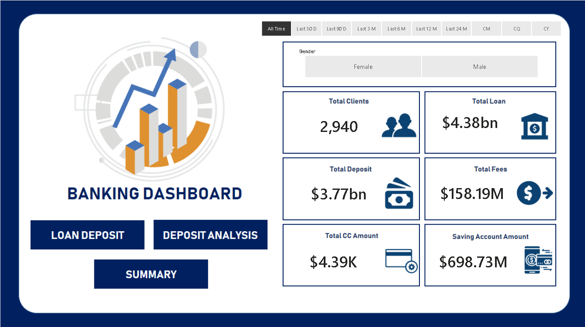
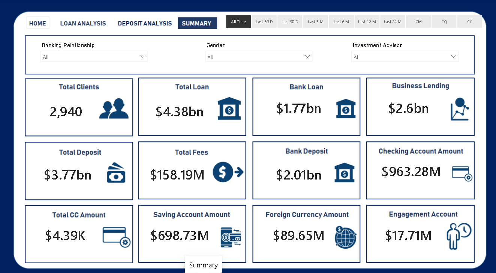

# 🏦 Banking Analytics Project

An end-to-end banking analytics project focused on exploring banking customer data and presenting financial insights using MySQL, Python, and Power BI.

## 📌 Project Overview

This project uses banking customer data to explore customer demographics, income, loans, deposits, and account balances. Python is used for exploratory data analysis and visualization, while Power BI is used to present the analysis through a multi-page dashboard.

## 🛠️ Tools & Technologies

- **MySQL:** Database creation and data exploration
- **Python:** Pandas, NumPy, Matplotlib, Seaborn
- **Power BI:** Dashboard development and visualization
- **GitHub:** Project documentation and version control
## 📂 Project Structure

```text
Banking-Analytics/
├── 01_dataset/
│   └── banking_customer_data.csv
├── 02_sql/
│   └── banking_analysis.sql
├── 03_python/
│   └── banking_eda.py
├── 04_dashboard/
│   └── banking_analytics.pbix
├── 05_screenshots/
│   ├── page1_Home.png
│   ├── page2_Loan Analysis.png
│   ├── page3_Deposit Analysis.png
│   └── page4_Summary.png
└── README.md
```


## 🔍 Project Workflow

1. **Dataset:** Used a banking customer dataset for analysis.
2. **Database:** Created a database in MySQL and explored the stored data.
3. **Python EDA:** Examined data structure, missing values, descriptive statistics, numerical distributions, correlations, and relationships between financial variables.
4. **Power BI:** Developed a multi-page dashboard to visualize banking data and present insights.

## 📊 Power BI Dashboard Preview

### Page 1 — Home



### Page 2 — Loan Analysis


### Page 3 — Deposit Analysis


### Page 4 — Summary



## 🎯 Project Objectives

- Explore customer financial profiles.
- Understand the distribution of loans, deposits, and account balances.
- Examine relationships between numerical banking features.
- Communicate findings through data visualization and an interactive dashboard.

## 💡 Skills Demonstrated

MySQL · Python · Pandas · NumPy · Exploratory Data Analysis · Matplotlib · Seaborn · Power BI · Data Visualization · GitHub
